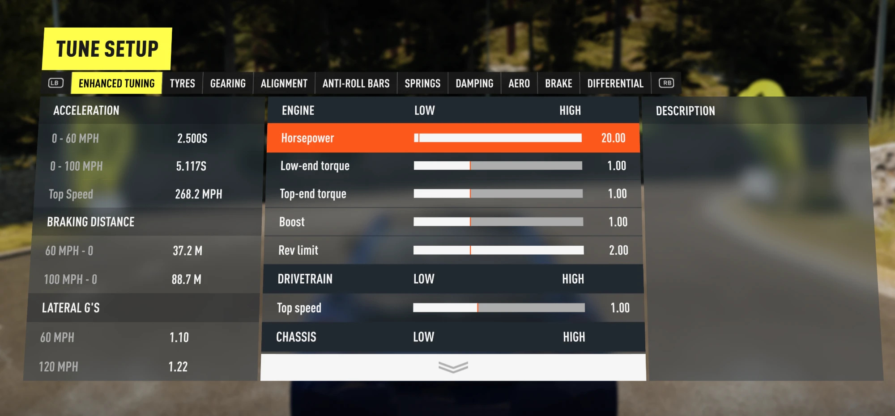

# Enhanced Tuning for Forza Horizon 2

An [Extra Options](https://github.com/RokkuDayo/ForzaHorizon2_ExtraOptions) plugin that adds an
**ENHANCED TUNING** tab to Forza Horizon 2's Tuning screen, with 15 sliders that go far beyond the
stock tuning menu: horsepower, torque curve shape, boost, rev limit, top speed, weight, steering
lock, brakes, grip, drag, downforce, and an "MW Handling" preset. Tunes are saved per car.

Everything happens in memory while the game runs. No game file is replaced or modified, every
patch checks the exact game bytes it expects first, and anything unexpected leaves the game stock
and writes a line to the log.



---

## Features

The ENHANCED TUNING tab sits **first** in the Tuning screen, left of Tires. Its sliders look and behave like the game's own tuning
sliders, with a marker showing stock and a help text for each row.

| Group | Slider | Range | What it changes |
|---|---|---|---|
| ENGINE | **Horsepower** | x0.5 – x20 | Scales engine torque at every rpm (the stock engine's torque curve scale), so horsepower changes by the same factor. |
| | **Low-end torque** | x0.5 – x2 | Reshapes the torque curve low in the rev range (fading out by two thirds of the redline). |
| | **Top-end torque** | x0.5 – x2 | Reshapes the torque curve high in the rev range. |
| | **Boost** | x0 – x3 | Scales the torque a turbo or supercharger adds (x0 removes it). Naturally aspirated cars only change once forced induction is fitted. |
| | **Rev limit** | x0.5 – x2 | Scales the redline (and the torque curve's top end when needed). |
| DRIVETRAIN | **Top speed** | x0.7 – x1.5 | Lengthens or shortens the final drive of every transmission level. |
| CHASSIS | **Weight** | x0.5 – x1.5 | Scales the car's mass at every weight-reduction level. |
| | **Steering lock** | x0.7 – x1.3 | Scales the maximum steering angle (wheel and controller). |
| BRAKES | **Brake force** | x0.25 – x4 | Scales braking friction at every brake upgrade level. |
| GRIP | **Front** / **Rear** | x0.25 – x4 | Scales tire friction front / rear at every chassis upgrade level. |
| AERO | **Drag** | x0.25 – x4 | Scales aerodynamic drag. |
| | **Front downforce** / **Rear downforce** | x0.25 – x4 | Scales the body's downforce (cars with no stock downforce are unaffected). |
| MW HANDLING | **MW Handling** | 0 – 1 | Blends the car toward Need for Speed: Most Wanted (2005)-style handling: more grip (slower classes gain more), a downforce floor that also cures rear lift, a stronger rear stability boost, less steering lock at speed, quicker steering and countersteer, and a stronger handbrake and brakes. Grip, Brake force and Downforce multiply on top. See [docs/mw_handling.md](docs/mw_handling.md). |

Also:

- **Pause menu tile:** the Cars tab's *Tune Car* tile is retitled **ENHANCED TUNING**.
- **Applies without a car swap:** after you stop moving a slider for about a second, the car is
  re-prepared from the database and **rebuilt in place** (the game's own "apply upgrades" rebuild,
  Car vtable slot 0x48). Leaving Tuning also reloads the car (with Get in Car on).
- **Stat screens show the tuned horsepower** (car select, dealers, upgrades): power and torque are
  multiplied by the Horsepower slider. This is **display only**: class, PI and your saved garage
  data are not changed.
- **Per-car tunes** are saved to `tunes.ini` and re-applied every session.

**Good to know:**

- Sliders are multipliers on the car's stock database values; **x1.00 is stock** and always writes
  the exact stock value back. Values never compound.
- Edits are per car model. **Boost** and **Rev limit** edit engine rows that are shared by every car
  using the same stock engine; the log names any other car affected. Torque curves and
  drivetrains are rarely shared (the log says so when they are).
- The changes are made to Extra Options' merged in-memory database only. Nothing is written to the
  game's files. Enhanced Tuning is designed not to write tuned values into your save (the
  stat-screen horsepower is display-only), but as with any mod, **back up your save** first.

## Requirements

| Requirement | Version tested | Where to get it |
|---|---|---|
| **Forza Horizon 2** (Xbox One version) | Build **1.0.0.64** | Your own copy (you must own the game; nothing from it is included here) |
| **Azimuth** | **1.0.1** | [almost-there-games.itch.io/azimuth](https://almost-there-games.itch.io/azimuth) |
| **Forza Horizon 2 Extra Options** by RokkuDayo | **0.3.0** | [github.com/RokkuDayo/ForzaHorizon2_ExtraOptions](https://github.com/RokkuDayo/ForzaHorizon2_ExtraOptions) |

Turn on Extra Options' **Get in Car from the pause menu** option, so that leaving Tuning reloads
the car with your changes. (Without it everything else still works, and changes still apply about a
second after you stop moving a slider.)

Tested on Windows 11 (64-bit). On a different game build Enhanced Tuning checks the game code first and simply does nothing.

## Install

1. Install and set up **Azimuth 1.0.1** and **Extra Options 0.3.0** first, and check the game runs
   with Extra Options (there is an `FH2_ExtraOptions.log` beside `Azimuth.exe`).
2. Download **`FH2-EnhancedTuning-1.0.0.zip`** from this repository's **Releases** page and drag the **`mods`** folder inside it onto your Azimuth folder (the one with `azimuth.exe`). Say yes if Windows asks to merge folders. You get:

   ```
   <Azimuth folder>\mods\Enhanced Tuning\mod.json
   <Azimuth folder>\mods\Enhanced Tuning\database.json
   <Azimuth folder>\mods\Enhanced Tuning\strings.json
   <Azimuth folder>\mods\Enhanced Tuning\LiveTune.ini
   <Azimuth folder>\mods\Enhanced Tuning\plugins\EnhancedTuning.dll
   ```

3. That's it: Extra Options turns on any new mod folder it finds in `mods\` the next time the game starts, so you don't need to edit `loadorder.txt`. (It adds the mod at the end of your load order; move the `Enhanced Tuning` line if you want it elsewhere, and change it to `# Enhanced Tuning` to switch the mod off.)
4. Start the game.

## Usage

1. Drive in free roam, open the pause menu, go to **Cars** and choose **ENHANCED TUNING** (the
   Tune Car tile).
2. The **ENHANCED TUNING** tab is the first tab. Move a slider; the right-hand value shows the
   multiplier and the marker shows stock.
3. Leave Tuning. The car reloads with your changes and you keep driving. (Changes also apply in
   place about a second after you stop moving a slider.)
4. To undo a change, move the slider back to its marker (x1.00, or 0 for MW Handling). A car whose
   sliders are all back at stock is removed from `tunes.ini`.

Tunes apply to the car you are driving; a car that isn't the current one gets its tune the next
time it is selected.

## Uninstall

1. Remove the `Enhanced Tuning` line from `mods\loadorder.txt`.
2. Delete `mods\Enhanced Tuning\` (back up `tunes.ini` first if you want to keep your tunes).

That's all: no game file was ever changed, and the next start is stock.

---

## Credits and legal

See [CREDITS.md](CREDITS.md). This project is not affiliated with or endorsed by Playground Games,
Turn 10 Studios, Microsoft, Electronic Arts, Almost There Games or the Extra Options author.
**No game files are included.** You need your own copy of Forza Horizon 2.

License: [GPL-3.0](LICENSE), the same licence as Extra Options, whose plugin API header `src\fh2_plugin.h` is included.

---

## AI use

This project was made with the help of AI (Claude by Anthropic). It was tested in game, but treat it as hobby software and keep backups of your saves.
