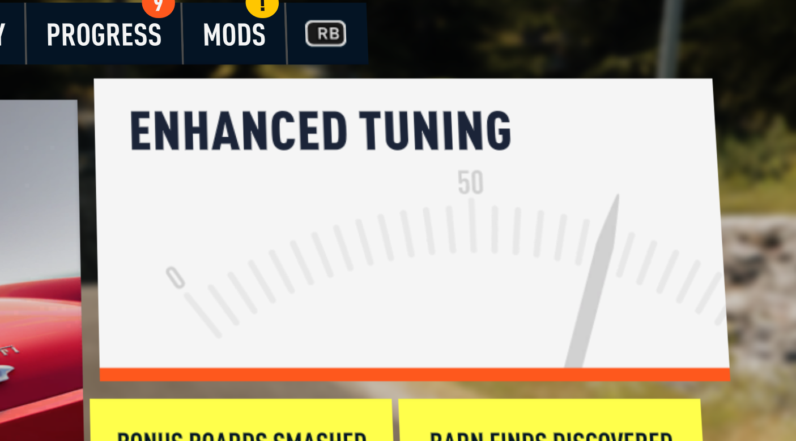

# Enhanced Tuning for Forza Horizon 2

An [Extra Options](https://github.com/RokkuDayo/ForzaHorizon2_ExtraOptions) plugin that adds an
**ENHANCED TUNING** tab to Forza Horizon 2's Tuning screen, with 15 sliders that go far beyond the
stock tuning menu: horsepower, torque curve shape, boost, rev limit, top speed, weight, steering
lock, brakes, grip, drag, downforce, and an "MW Handling" preset. Tunes are saved per car.

Everything happens in memory while the game runs. No game file is replaced or modified, every
patch checks the exact game bytes it expects first, and anything unexpected leaves the game stock
and writes a line to the log.

<!-- Screenshot placeholders: add images under docs/screenshots/ and uncomment.



-->

> **Screenshots:** _coming soon_ (see the placeholders in this file's source).

---

## Requirements

You need **all** of the following. These are the exact versions Enhanced Tuning was built and
tested with; other versions are not supported, and on a different game build the plugin's
byte checks fail and it simply does nothing (see [Troubleshooting](#troubleshooting)).

| Requirement | Version tested | Where to get it | Why it's needed |
|---|---|---|---|
| **Forza Horizon 2** (Xbox One version) | Build **1.0.0.64** (`Anthem_1.0.0.64_x64`) | Your own copy. **You must own the game**; nothing from it is included here. | The game itself. Every address the plugin patches is specific to this build's `forza_durango_release_final.exe`. |
| Forza Horizon 2 **Storm Island** DLC | 1.0.0.36 | Your own copy | **Optional.** Enhanced Tuning works with or without it. |
| **Azimuth** | **1.0.1** | [almost-there-games.itch.io/azimuth](https://almost-there-games.itch.io/azimuth) | The translation layer that runs the Xbox One game on Windows. Extra Options (and so this plugin) runs inside it. |
| **Forza Horizon 2 Extra Options** by RokkuDayo | **0.3.0** | [github.com/RokkuDayo/ForzaHorizon2_ExtraOptions](https://github.com/RokkuDayo/ForzaHorizon2_ExtraOptions) | The mod loader and plugin API. It loads this plugin from `mods\`, hands it the merged in-memory game database the sliders edit, owns the UI hook that the Tuning page and pause-menu edits chain onto, and provides the Get in Car reload used when you leave Tuning. |

Tested on Windows 11 (64-bit).

### Extra Options settings this mod depends on

These live in `FH2_ExtraOptions.ini`, beside `Azimuth.exe`. The defaults that ship with Extra
Options 0.3.0 are fine; check them if something is missing.

| Setting | Needed value | What it's for | If it's off |
|---|---|---|---|
| `[Global] Enabled` | `1` | Turns Extra Options' features on, including the UI hook and Get in Car. | No ENHANCED TUNING page or reload. Log: `LIVETUNE PAGE: Extra Options' UI hook isn't active; the tab has no page of its own.` and/or `LIVETUNE RELOAD: Extra Options' Get in Car is off; ...` |
| `[Frontend] GetInCarFromPauseMenu` | `1` | Enhanced Tuning points the Tuning screen's Back exit at Extra Options' Get in Car reload, so **leaving Tuning respawns the car with your changes**. | Everything else still works, and changes still apply in place while you drive (see [Usage](#usage)), but leaving Tuning no longer reloads the car. Log: `LIVETUNE RELOAD: Extra Options' Get in Car is off; leave Tuning and use Get in Car manually.` |
| Mod loading (`mods\loadorder.txt`) | `Enhanced Tuning` listed | Extra Options only loads mods listed there. The mod's (empty) `database.json` is what makes Extra Options build the merged in-memory database and hand it to the plugin. | Nothing from this mod loads: no `LIVETUNE` lines in the log at all. If the plugin loads but the database never arrives, the sliders don't change anything and you won't see `LIVETUNE DB: merged database connection received.` |
| Extra Options' UI hook | active (automatic with Extra Options 0.3.0 enabled) | The Tuning page panel and the pause-menu tile title are inserted into the screens as the game loads them, chained after Extra Options' own edits. | Log: `LIVETUNE PAGE: Extra Options' UI hook isn't active; the tab has no page of its own.` |

`[Files] EnableMediaOverrides` is **not** needed: this mod ships no media files.

### Compatibility notes

- **Set Time & Weather FH2** (the companion mod) works alongside Enhanced Tuning; both chain onto
  Extra Options' UI hook, in either load order.
- **FH2 Mod Platform / FnFNitro and the KITT (Knight Rider) mod** both hook the speedometer at
  `game+0xAD6070`, so don't run *their* HUD hooks together with each other. Enhanced Tuning does
  not touch that address or the HUD, so it isn't affected either way.
- Other mods that edit the **Tuning screen** (`A_TuningOptions`), the **pause menu**
  (`A_PauseMenu`), the **pause-menu flow** (`pause.xml`) or the car **stat screens** may conflict.
  Enhanced Tuning edits those in memory at fixed anchors and leaves a screen untouched (with a log
  line) if its anchors aren't found exactly once.
- Intended for offline / single-player play.

---

## Features

The ENHANCED TUNING tab sits **first** in the Tuning screen, left of Tires (or last, see
[Settings](#settings-livetuneini)). Its sliders look and behave like the game's own tuning
sliders, with a marker showing stock and a help text for each row.

| Group | Slider | Range | What it changes |
|---|---|---|---|
| ENGINE | **Horsepower** | x0.5 – x20 | Scales engine torque at every rpm (the stock engine's torque curve scale), so horsepower changes by the same factor. |
| | **Low-end torque** | x0.5 – x2 | Reshapes the torque curve low in the rev range (fading out by two thirds of the redline). |
| | **Top-end torque** | x0.5 – x2 | Reshapes the torque curve high in the rev range. |
| | **Boost** | x0 – x3 | Scales the torque a turbo or supercharger adds (x0 removes it). Naturally aspirated cars only change once forced induction is fitted. |
| | **Rev limit** | x0.5 – x2 | Scales the redline (and the torque curve's top end when needed). |
| DRIVETRAIN | **Top speed** | x0.7 – x1.5 | Lengthens or shortens the final drive of every transmission level. |
| CHASSIS | **Weight** | x0.5 – x1.5 | Scales the car's mass at every weight-reduction level. |
| | **Steering lock** | x0.7 – x1.3 | Scales the maximum steering angle (wheel and controller). |
| BRAKES | **Brake force** | x0.25 – x4 | Scales braking friction at every brake upgrade level. |
| GRIP | **Front** / **Rear** | x0.25 – x4 | Scales tire friction front / rear at every chassis upgrade level. |
| AERO | **Drag** | x0.25 – x4 | Scales aerodynamic drag. |
| | **Front downforce** / **Rear downforce** | x0.25 – x4 | Scales the body's downforce (cars with no stock downforce are unaffected). |
| MW HANDLING | **MW Handling** | 0 – 1 | Blends the car toward Need for Speed: Most Wanted (2005)-style handling: more grip (slower classes gain more), a downforce floor that also cures rear lift, a stronger rear stability boost, less steering lock at speed, quicker steering and countersteer, and a stronger handbrake and brakes. Grip, Brake force and Downforce multiply on top. See [docs/mw_handling.md](docs/mw_handling.md). |

Also:

- **Pause menu tile:** the Cars tab's *Tune Car* tile is retitled **ENHANCED TUNING**.
- **Applies without a car swap:** after you stop moving a slider for about a second, the car is
  re-prepared from the database and **rebuilt in place** (the game's own "apply upgrades" rebuild,
  Car vtable slot 0x48). Leaving Tuning also reloads the car (with Get in Car on).
- **Stat screens show the tuned horsepower** (car select, dealers, upgrades): power and torque are
  multiplied by the Horsepower slider. This is **display only**: class, PI and your saved garage
  data are not changed. Can be turned off.
- **Per-car tunes** are saved to `tunes.ini` and re-applied every session.

**Good to know:**

- Sliders are multipliers on the car's stock database values; **x1.00 is stock** and always writes
  the exact stock value back. Values never compound.
- Edits are per car model. **Boost** and **Rev limit** edit engine rows that are shared by every car
  using the same stock engine; the log names any other car affected. Torque curves and
  drivetrains are rarely shared (the log says so when they are).
- The changes are made to Extra Options' merged in-memory database only. Nothing is written to the
  game's files. Enhanced Tuning is designed not to write tuned values into your save (the
  stat-screen horsepower is display-only), but as with any mod, **back up your save** first.

---

## Install

1. Install and set up **Azimuth 1.0.1** and **Extra Options 0.3.0** first, and check the game runs
   with Extra Options (there is an `FH2_ExtraOptions.log` beside `Azimuth.exe`).
2. Download **`FH2-EnhancedTuning-1.0.0.zip`** from this repository's **Releases** page and drag the **`mods`** folder inside it onto your Azimuth folder (the one with `azimuth.exe`). Say yes if Windows asks to merge folders. You get:

   ```
   <Azimuth folder>\mods\Enhanced Tuning\mod.json
   <Azimuth folder>\mods\Enhanced Tuning\database.json
   <Azimuth folder>\mods\Enhanced Tuning\strings.json
   <Azimuth folder>\mods\Enhanced Tuning\LiveTune.ini
   <Azimuth folder>\mods\Enhanced Tuning\plugins\EnhancedTuning.dll
   ```

3. That's it: Extra Options turns on any new mod folder it finds in `mods\` the next time the game starts, so you don't need to edit `loadorder.txt`. (It adds the mod at the end of your load order; move the `Enhanced Tuning` line if you want it elsewhere, and change it to `# Enhanced Tuning` to switch the mod off.)
4. Make sure `GetInCarFromPauseMenu=1` in `FH2_ExtraOptions.ini` (see [Requirements](#extra-options-settings-this-mod-depends-on)).
5. Start the game. `FH2_ExtraOptions.log` should contain `LIVETUNE: Enhanced Tuning 1.0.0 ready.`

## Usage

1. Drive in free roam, open the pause menu, go to **Cars** and choose **ENHANCED TUNING** (the
   Tune Car tile).
2. The **ENHANCED TUNING** tab is the first tab. Move a slider; the right-hand value shows the
   multiplier and the marker shows stock.
3. Leave Tuning. The car reloads with your changes and you keep driving. (Changes also apply in
   place about a second after you stop moving a slider.)
4. To undo a change, move the slider back to its marker (x1.00, or 0 for MW Handling). A car whose
   sliders are all back at stock is removed from `tunes.ini`.

Tunes apply to the car you are driving; a car that isn't the current one gets its tune the next
time it is selected.

## Settings (`LiveTune.ini`)

In the mod folder. Restart the game after changing it.

```ini
[Tab]
; first (left of Tires, default) or last (after Differential)
Position=first

[Display]
; 1 = stat screens show power and torque x the Horsepower slider (display only, default)
; 0 = stat screens show the stock figures
ScalePower=1
```

### Saved tunes (`tunes.ini`)

Created in the mod folder the first time you change a slider. One section per car, keyed by the
game's car id, one line per non-stock slider, for example:

```ini
[Car2286]
LiveTuneHorsepower=1.50
LiveTuneGripFront=1.30
LiveTuneGripRear=1.30
```

You can edit or delete sections by hand while the game is closed. Values outside a slider's
range are ignored (with a log line). Delete the file to reset every car to stock.

## Uninstall

1. Remove the `Enhanced Tuning` line from `mods\loadorder.txt`.
2. Delete `mods\Enhanced Tuning\` (back up `tunes.ini` first if you want to keep your tunes).

That's all: no game file was ever changed, and the next start is stock.

---

## Troubleshooting

Everything Enhanced Tuning does is logged to **`FH2_ExtraOptions.log`** (beside `Azimuth.exe`),
on lines starting with `LIVETUNE`. A healthy start looks like this (order may vary):

```
LIVETUNE TAB: Enhanced Tuning tab added as tab 1 of 10.
LIVETUNE SLIDER: 15 sliders registered on the slider rows (Tuning/Benchmark) type.
LIVETUNE SLIDER: 15 sliders registered on the tab bar (Categories) type.
LIVETUNE PAGE: chained onto Extra Options' UI hook.
LIVETUNE RELOAD: hooked the menu-flow parser after Extra Options' edits.
LIVETUNE HP: stat screens show power and torque x the Horsepower slider (display only).
LIVETUNE: Enhanced Tuning 1.0.0 ready.
LIVETUNE DB: merged database connection received.
LIVETUNE RELOAD: leaving Tuning now reloads the car.
LIVETUNE PAGE: Tune Car tile retitled "ENHANCED TUNING".
LIVETUNE PAGE: Enhanced Tuning page added to the Tuning screen.
```

| Symptom | Log line to look for | What to do |
|---|---|---|
| No `LIVETUNE` lines at all | — | The mod isn't loaded. Check the folder is `mods\Enhanced Tuning\` with `plugins\EnhancedTuning.dll` inside, and that `Enhanced Tuning` is in `mods\loadorder.txt`. |
| No tab, or no sliders | `LIVETUNE TAB: unexpected code at game+0x...; tab not added.` / `... tuning tab table not initialised as expected ...` / `LIVETUNE SLIDER: Tuning page type didn't match; sliders not added.` | The game build isn't 1.0.0.64, or another mod patched the Tuning menu code first. |
| Tab is there but empty | `LIVETUNE PAGE: Extra Options' UI hook isn't active; the tab has no page of its own.` | Extra Options isn't enabled, or isn't 0.3.0. |
| | `LIVETUNE PAGE: Tuning screen layout did not match; Enhanced Tuning page not added.` | Another mod changed the Tuning screen's layout. |
| Leaving Tuning doesn't reload the car | `LIVETUNE RELOAD: Extra Options' Get in Car is off; ...` | Set `GetInCarFromPauseMenu=1` in `FH2_ExtraOptions.ini`. |
| | `LIVETUNE RELOAD: pause menu flow didn't match (Get in Car sequence missing?); Tuning exit unchanged.` | Extra Options' Get in Car sequence wasn't in the pause-menu flow, or another mod edited it. Use Get in Car manually. |
| Sliders move but nothing changes | no `LIVETUNE DB: merged database connection received.` | Extra Options didn't hand over the database: check `database.json` is in the mod folder and the mod is in `loadorder.txt`. |
| | `LIVETUNE DB: <column> not in this database; ... skips it.` / `... that slider is disabled.` | The game database doesn't have that column (different game build or another database mod). |
| | `LIVETUNE: in-place rebuild skipped (...)` / `LIVETUNE: car re-prepare skipped (...); swap cars to apply.` | Apply by leaving Tuning, or swap to another car and back. |
| Boost does nothing | `LIVETUNE: car ... LiveTuneBoost: the stock engine is naturally aspirated; ...` | Expected: fit a turbo or supercharger upgrade first. |
| Stat screen shows stock hp | `LIVETUNE HP: stat-screen power scaling off ...` or `... stat-screen code didn't match ...` | Set `ScalePower=1`, or the game build differs. |

When reporting a problem, include the `LIVETUNE` lines from the log and your versions of the game,
Azimuth and Extra Options.

---

## Build from source

Requirements:

- **Zig 0.15.2** ([ziglang.org/download](https://ziglang.org/download/)), the same compiler Extra
  Options uses. Only `zig cc` is used; the plugin is plain C.
- Windows (the build script is a `.cmd` file).
- Optional, for the research helpers in `tools\`: **Python 3** and `pip install capstone`.

Build:

```
build.cmd C:\path\to\zig.exe
```

(or just `build.cmd` if `zig` is on your `PATH`). This writes
`release\Enhanced Tuning\plugins\EnhancedTuning.dll`; the rest of `release\Enhanced Tuning\` is
checked in as-is. The build uses `-Wall -Werror`.

There are no offline tests for Enhanced Tuning; changes need checking in game (the log lines
above are the quickest check). The research tools in `tools\` (`disasm.py`, `xref.py`, `strref.py`,
`dataref.py`) read **your own** `forza_durango_release_final.exe`; pass its path on the command
line. Nothing from the game is included in this repository.

### Repository layout

| Path | What |
|---|---|
| `src\` | Plugin source (C). `livetune.c` is the entry point; each file starts with a comment explaining what it patches and why. `fh2_plugin.h` is Extra Options' plugin API header. |
| `release\Enhanced Tuning\` | The ready-to-copy mod folder, as built. |
| `docs\` | Research notes: how the tab, the reload, the car cache, the stat screens and the MW Handling preset work, with the game addresses (RVAs) involved. `DESIGN.md` is the original design log. |
| `tools\` | Small reverse-engineering helpers used during development (they read your own game EXE). |
| `build.cmd` | Build script. |

---

## Credits and legal

See [CREDITS.md](CREDITS.md). This project is not affiliated with or endorsed by Playground Games,
Turn 10 Studios, Microsoft, Electronic Arts, Almost There Games or the Extra Options author.
**No game files are included.** You need your own copy of Forza Horizon 2.

License: [GPL-3.0](LICENSE), the same licence as Extra Options, whose plugin API header `src\fh2_plugin.h` is included.

---

## AI use

This project was made with the help of AI (Claude by Anthropic). It was tested in game, but treat it as hobby software and keep backups of your saves.
